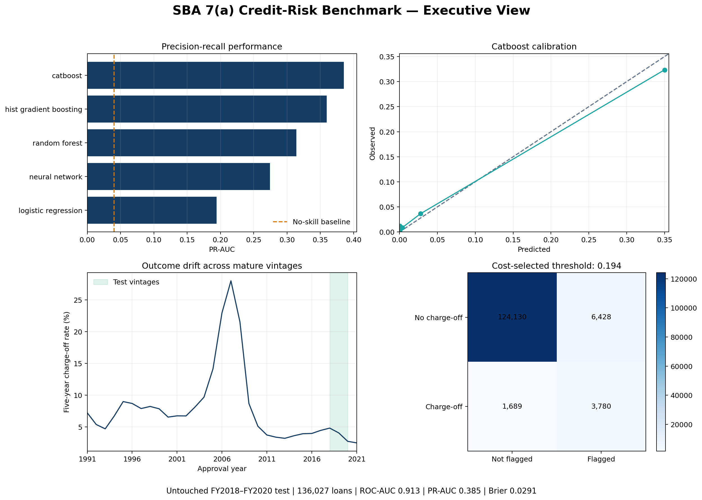
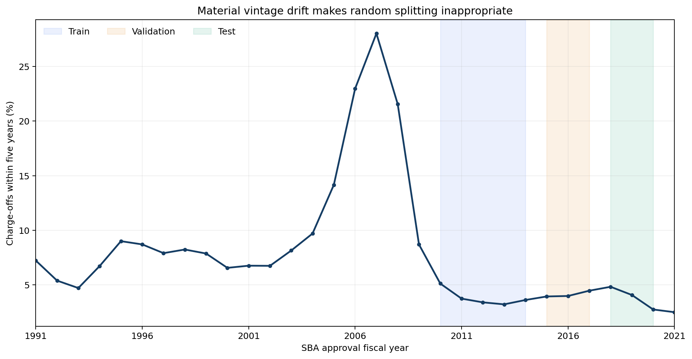
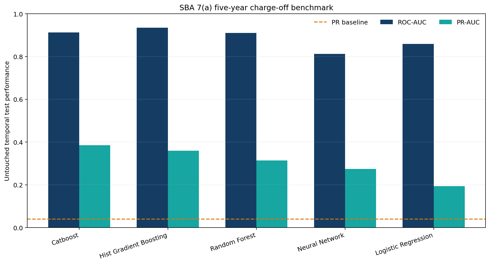
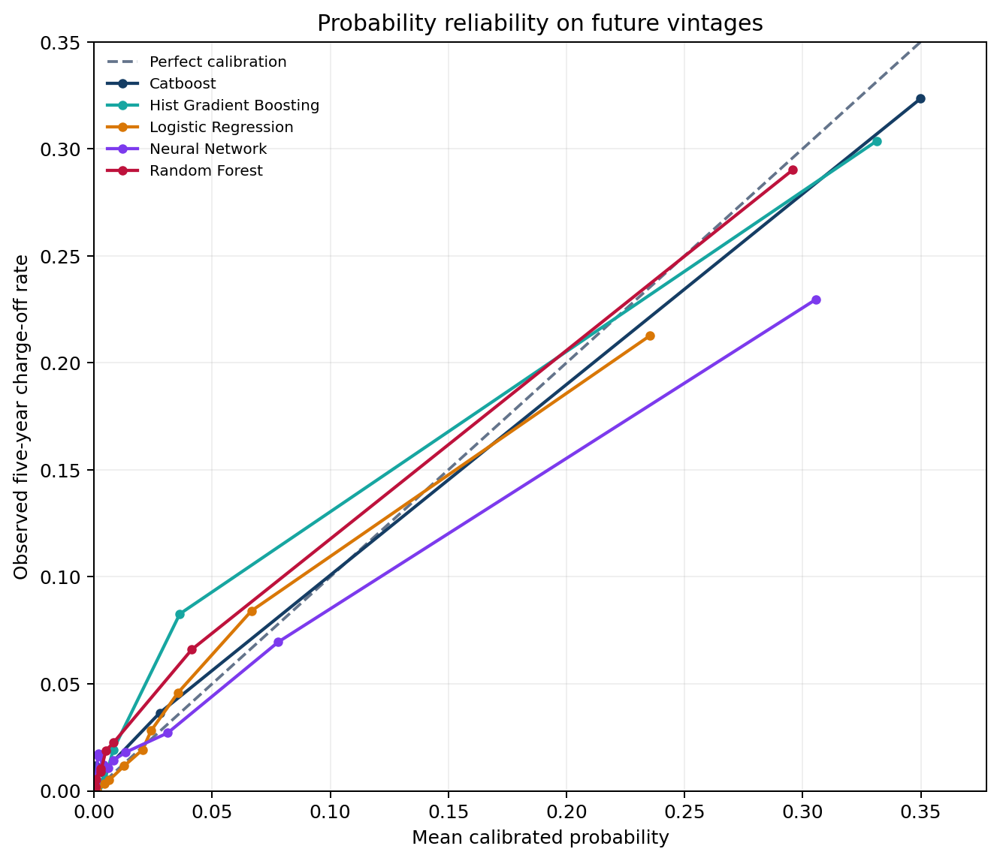
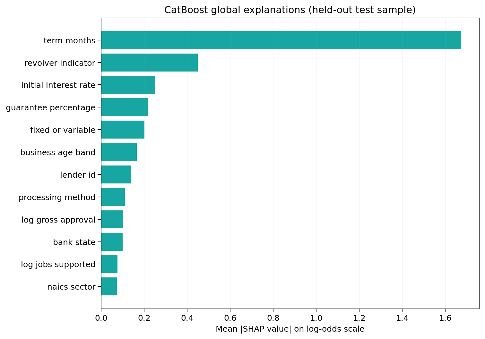

# SBA 7(a) Credit-Risk ML Benchmark

[](https://github.com/JithuVathiath/credit-risk-ml-benchmark/actions/workflows/ci.yml)
[](https://www.python.org/)
[](LICENSE)
[](https://data.sba.gov/dataset/7a-504-foia)

A reproducible, leakage-controlled benchmark for predicting **charge-off within five years**
among approved and disbursed U.S. Small Business Administration 7(a) loans.

This is not another random-split credit tutorial. It processes 1.96 million official records,
constructs a maturity-aware outcome, evaluates five model families on future approval vintages,
calibrates probabilities, selects an explicit cost threshold, audits drift and subgroups, and
publishes only reproducible aggregate results.



## Headline results

The published full run used the official 30 June 2026 SBA snapshot and **514,825 eligible
FY2010–FY2020 loans**. CatBoost was selected by validation PR-AUC before the test set was scored.

| Model | Test ROC-AUC | Test PR-AUC | Brier score | Validation PR-AUC |
|---|---:|---:|---:|---:|
| **CatBoost** | **0.913** | **0.385** | **0.0291** | **0.616** |
| Histogram gradient boosting | 0.935 | 0.360 | 0.0301 | 0.555 |
| Random forest | 0.910 | 0.314 | 0.0316 | 0.537 |
| Neural network | 0.813 | 0.274 | 0.0337 | 0.457 |
| Logistic regression | 0.860 | 0.194 | 0.0346 | 0.215 |

The untouched test charge-off rate—and therefore the no-skill PR-AUC baseline—was **0.040**.
CatBoost's test ROC-AUC 95% stratified-bootstrap interval was **0.909–0.917**, and its PR-AUC
interval was **0.376–0.398**.

At the validation-selected threshold of 0.194 under an illustrative 5:1 missed-charge-off versus
false-alert cost ratio, CatBoost achieved **69.1% recall** and **37.0% precision** on the test set.
The ratio is an analytical scenario, not an SBA policy or deployment recommendation.

> Histogram boosting had the highest test ROC-AUC. It was not retrospectively declared the
> winner because the preregistered selection metric was validation PR-AUC. CatBoost also retained
> the strongest test PR-AUC, the more decision-relevant discrimination metric for this imbalanced
> outcome.

## Why the validation design matters

Five-year charge-off rates changed substantially across SBA vintages, including a sharp peak
around the financial crisis. A random split would mix economic regimes and overstate confidence
about future performance.

| Partition | SBA approval fiscal years | Loans | Charge-off rate | Role |
|---|---:|---:|---:|---|
| Train | FY2010–FY2014 | 210,671 | 3.81% | Fit preprocessing and models |
| Validation | FY2015–FY2017 | 168,127 | 4.13% | Calibrate, select model and threshold |
| Test | FY2018–FY2020 | 136,027 | 4.02% | Final evaluation only |



The broader drift analysis covers **1,440,954 mature loans from FY1991 onward**. Model development
starts in FY2010 because important origination fields are absent from earlier extracts.

## What is implemented

- Official four-file SBA ingestion with pinned URLs, sizes, record counts, and SHA-256 checksums
- Chunked loading that never reads borrower names or street-level identifiers
- Fixed 1,826-day outcome window anchored at first disbursement
- Explicit cancellation, commitment, maturity, invalid-date, and censoring controls
- A tested leakage quarantine for status, payoff, charge-off, snapshot, and post-origination fields
- Logistic regression, random forest, histogram boosting, CatBoost, and multilayer perceptron
- Isotonic probability calibration fit only on validation data
- Validation-only cost-threshold selection and full threshold tables
- ROC-AUC, PR-AUC, Brier score, log loss, ECE, precision, recall, F1, and balanced accuracy
- Bootstrap confidence intervals, calibration curves, timing, and annual test stability
- SHAP and permutation explanations for the categorical boosting model
- Aggregate error and operational subgroup reports with sample sizes
- Full and deterministic quick modes, Docker, tests, CI, and versioned benchmark artifacts

## Outcome and leakage definition

The target is `1` when a loan is charged off within 1,826 days after first disbursement and `0`
otherwise. A loan enters the cohort only if the full horizon is observable in the snapshot.
Cancelled and undisbursed records are excluded.

Lifecycle variables are used only to construct this label. They cannot reach a model:

```text
LoanStatus · PaidInFullDate · ChargeOffDate · GrossChargeOffAmount
AsOfDate · SoldSecMrktInd
```

See the [evaluation protocol](docs/evaluation-protocol.md) for the complete estimand and the
[data card](docs/data-card.md) for field-level decisions.

## Reproduce the results

Python 3.11 or newer and approximately 1 GB of free space are required.

```bash
git clone https://github.com/JithuVathiath/credit-risk-ml-benchmark.git
cd credit-risk-ml-benchmark
python -m venv .venv
source .venv/bin/activate
python -m pip install -e ".[dev,benchmark]"
python scripts/download_data.py
credit-risk-benchmark --mode full --bootstrap-resamples 200
```

The downloader uses only the official SBA catalogue, skips already verified files, and rejects
checksum mismatches. Raw data is intentionally excluded from Git.

For a faster end-to-end rehearsal:

```bash
credit-risk-benchmark --mode quick --bootstrap-resamples 30 \
  --output-dir artifacts/quick-run
```

Quick mode preserves the time boundaries but deterministically limits the three partitions. Its
metrics are diagnostic and are not substituted for the full results above.

### Docker

```bash
docker build -t sba-credit-risk .
docker run --rm \
  -v "$PWD/data:/app/data" \
  -v "$PWD/reports:/app/reports" \
  sba-credit-risk --mode full --bootstrap-resamples 200
```

Download and verify the source files on the host before starting the container.

## Results and explanations



All scores are probability-calibrated on FY2015–FY2017 before future-vintage evaluation.
Calibration improved probability interpretation, while the full reliability table preserves bin
sizes and observed rates for review.



Term length was the dominant CatBoost explanation under both mean absolute SHAP magnitude and
permutation testing. These are descriptions of fitted model behaviour—not causal findings or
automatically valid underwriting reasons.



Machine-readable outputs are available in [`reports/metrics`](reports/metrics), with exact input
hashes, versions, configuration, and runtime in
[`reports/run_metadata.json`](reports/run_metadata.json). The concise generated result is in
[`reports/benchmark-summary.md`](reports/benchmark-summary.md).

## Responsible use and fairness boundary

The SBA extract contains already-approved loans and does not provide protected-class attributes.
Accordingly, this project **does not claim demographic fairness or fairness of approval
decisions**. Business type, business-age band, and fiscal-year tables are operational performance
checks, not substitutes or proxies for protected groups.

This repository is research and decision-support code. It is not a lending product, financial
advice, a credit decision, a causal study, or evidence of legal compliance. Read the
[responsible-AI scope](docs/responsible-ai.md) before interpreting subgroup or explanation output.

## Repository map

```text
.
├── data/
│   ├── README.md                  # access, licence, and privacy notes
│   └── sources.json              # pinned official snapshot manifest
├── docs/
│   ├── architecture.md
│   ├── data-card.md
│   ├── evaluation-protocol.md
│   ├── reproducibility.md
│   └── responsible-ai.md
├── reports/
│   ├── benchmark-summary.md
│   ├── figures/                  # publication-ready benchmark visuals
│   ├── metrics/                  # aggregate CSV evidence
│   └── run_metadata.json
├── scripts/download_data.py
├── src/credit_risk_benchmark/
│   ├── benchmark.py              # experiment orchestration and reports
│   ├── cli.py
│   ├── data.py                   # cohort and leakage controls
│   ├── metrics.py
│   ├── models.py
│   └── validation.py
├── tests/
├── Dockerfile
├── Makefile
└── pyproject.toml
```

## Documentation

- [Architecture and data flow](docs/architecture.md)
- [Data card](docs/data-card.md)
- [Evaluation protocol](docs/evaluation-protocol.md)
- [Reproducibility guide](docs/reproducibility.md)
- [Responsible-AI and fairness scope](docs/responsible-ai.md)
- [Contributing](CONTRIBUTING.md)
- [Security policy](SECURITY.md)

## Licence and attribution

Original code and documentation are released under the [MIT License](LICENSE). The SBA catalogue
labels the source data as U.S. Government Works/Public Domain; that designation does not transfer
the dataset into the repository or change the code licence.

If this project supports research, use the metadata in [`CITATION.cff`](CITATION.cff) and cite the
U.S. Small Business Administration as the data publisher.
