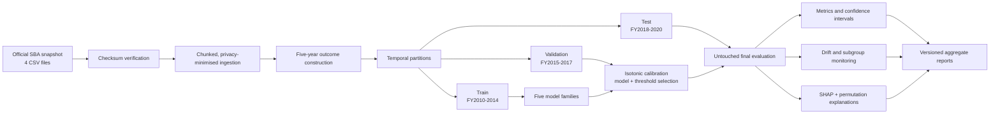

# Architecture

## Design choices

- **Chunked reads:** all four files are scanned without loading direct identifiers or the entire
  raw schema.
- **One cohort function:** tests exercise the same eligibility and label code used by the full
  benchmark.
- **Separate partitions:** fitting, calibration/selection, and final evaluation have explicit
  responsibilities.
- **Aggregate artifacts:** no row-level predictions are written to disk.
- **Pinned provenance:** a fresh SBA quarterly release cannot silently replace the benchmarked
  snapshot.
